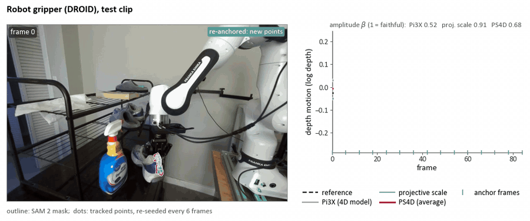
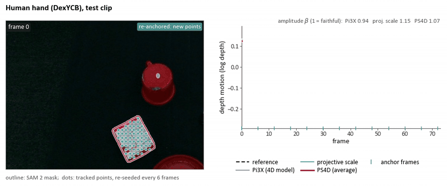
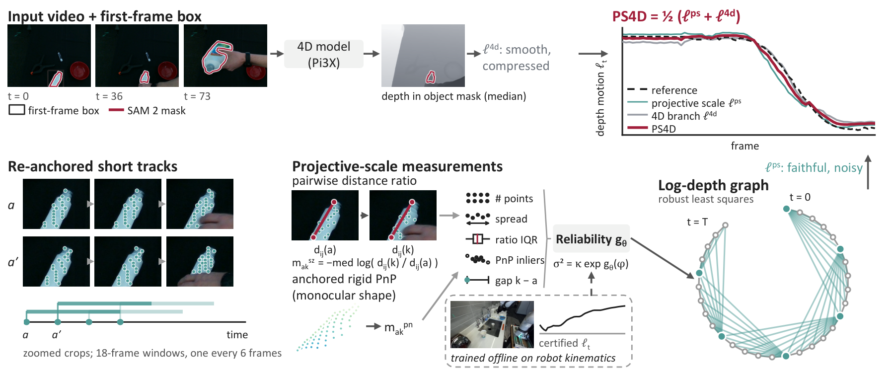
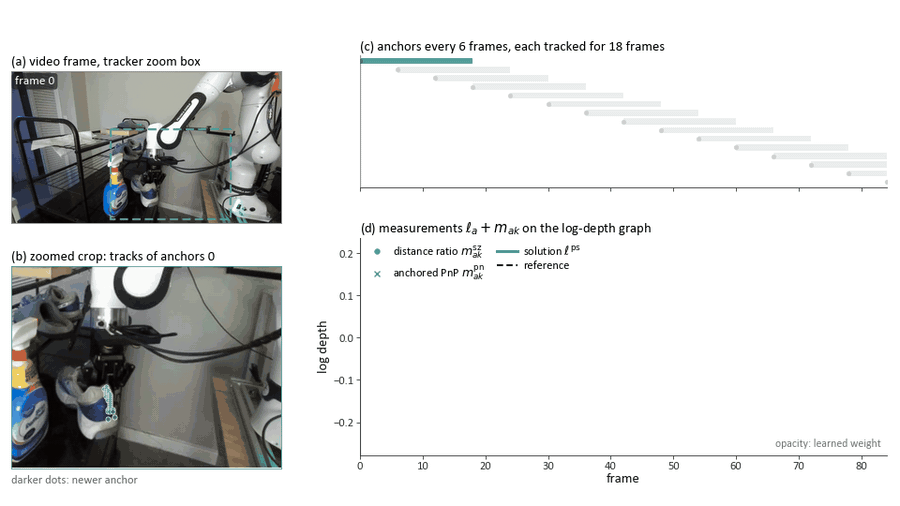
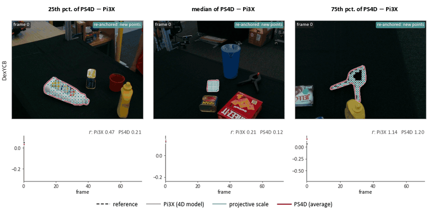
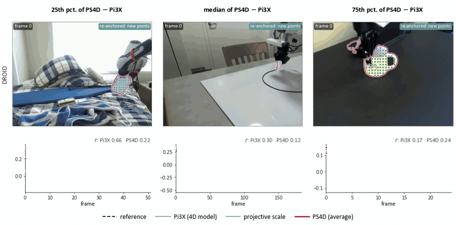
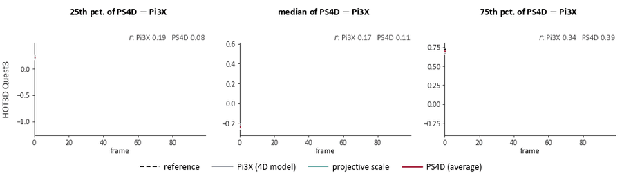

<div align="center">

# Size Speaks Depth

### Projective Scale Complements 4D Reconstruction of Manipulated Objects

**Yiming Chen &nbsp;·&nbsp; Cong Lou &nbsp;·&nbsp; Jian Chang &nbsp;·&nbsp; Li Yang &nbsp;·&nbsp; Wei Zhou**<sup>✉</sup>

School of Automation, Nanjing University of Science and Technology

<sup>✉</sup> Corresponding author: weizhou@njust.edu.cn


[Overview](#overview) &nbsp;|&nbsp; [Results](#results) &nbsp;|&nbsp; [Installation](#installation) &nbsp;|&nbsp; [Quick start](#quick-start) &nbsp;|&nbsp; [Reproduction](#reproduction) &nbsp;|&nbsp; [Citation](#citation)

</div>

**PS4D** recovers how a hand-held or robot-held object moves along the camera's line of sight from a single
monocular video. Monocular 4D reconstruction models mostly *compress* this motion; the object's own projective scale
records it at full amplitude, but noisily. PS4D measures the scale over short track windows that restart every few
frames, solves a log-depth graph, and averages the result with a 4D model.

<p align="center">
  
</p>
<p align="center">
  
</p>

<p align="center"><sub>
Held-out test clips of a robot gripper (DROID) and a human hand (DexYCB), each chosen as typical of its test set by a fixed rule.
Left: SAM&nbsp;2 outline and track points, re-seeded every 6 frames. Right: depth motion of the reference, Pi3X, the
projective-scale branch and PS4D. Pi3X compresses the robot's motion and spikes on the hand clip; PS4D follows the
reference most closely.
</sub></p>

---

## Contents

- [Overview](#overview)
- [Results](#results)
- [Installation](#installation)
- [Quick start](#quick-start)
- [Data preparation](#data-preparation)
- [Reproduction](#reproduction)
- [Repository layout](#repository-layout)
- [Citation](#citation)
- [Acknowledgments and licenses](#acknowledgments-and-licenses)

## Overview

PS4D estimates the **depth motion** of a manipulated object: the log of its median depth along the camera's line of
sight, `l_t = log Z_t`, up to an additive constant. The input is a monocular video, the camera intrinsics and a box
around the object in the first frame.

1. **Masks and re-anchored tracks.** SAM 2.1 propagates a mask from the box. Every W = 6 frames an anchor frame
   receives a grid of up to 64 points inside its mask, and CoTracker3 tracks them over the next H = 18 frames on a
   zoomed crop around the object.
2. **Projective-scale measurements.** Every pair (anchor *a*, frame *k*) gives two measurements of `l_k - l_a` that
   need no metric scale: the median log ratio of pairwise point distances (*size*), and the depth ratio of an
   anchored rigid PnP fit of the anchor's points lifted with MoGe-2 (*rigid*; SQPnP + RANSAC + Levenberg-Marquardt).
3. **Reliability learned from robot kinematics.** A gradient-boosted regressor predicts the variance of each
   measurement from eleven geometric statistics of the measurement (twelve input columns, one duplicated). It was
   trained once on 134,274 measurements from 963 DROID grasps in 15 buildings, with labels certified by the robot's
   forward kinematics, and is shipped with this repository.
4. **Log-depth graph.** A Huber-robust weighted least-squares solve (IRLS) over all measurements gives the
   projective-scale branch: faithful in amplitude, but noisy.
5. **Equal-weight fusion.** The 4D branch is the median depth of a 4D reconstruction model (Pi3X by default) inside
   the masks: smooth, but it compresses the motion. PS4D averages the two branches in log depth.

<p align="center">
  
</p>

<p align="center">
  
</p>
<p align="center"><sub>
Short re-anchored windows on a real test clip. Every 6 frames new points are seeded and tracked on a zoomed crop for
18 frames; each anchor–frame pair gives a log-depth change (distance ratio, anchored PnP), shown with an opacity
proportional to its learned weight, and all pairs are solved jointly on a log-depth graph. The curve is revealed over
time but is the solution for the whole clip.
</sub></p>

Evaluation reports, per clip, the residual ratio `r = ||d_hat - d|| / ||d||` of the centred estimate (1 = predicting
no motion), the absolute error `eps = r * sd(d)` in log depth and the amplitude `beta = <d_hat, d> / ||d||^2`
(< 1 compresses the motion), summarized by medians over clips with paired median differences and 95% bootstrap
intervals (2000 resamples).

## Results

Median over clips on the three test sets: DexYCB subjects 06-10 (500 clips), HOT3D Quest3 (375 clips) and DROID
held-out buildings (99 clips). `eps` is in log depth x 100 (about percent of depth). Best values in **bold**.

| Method | DexYCB r | eps | beta | HOT3D r | eps | beta | DROID r | eps | beta |
|---|---|---|---|---|---|---|---|---|---|
| Tracks + MoGe-2 | 1.095 | 7.56 | 0.40 | 0.712 | 9.66 | 0.68 | 1.000 | 7.69 | 0.80 |
| Tracks + VDA-L | 1.313 | 8.57 | 0.38 | 0.715 | 9.24 | 0.55 | 0.951 | 6.93 | 0.78 |
| SpatialTrackerV2 | 0.810 | 4.56 | 0.43 | 0.657 | 8.15 | 0.61 | 0.735 | 5.54 | 0.74 |
| pi3 | 1.095 | 7.05 | 1.09 | 0.513 | 6.71 | 0.86 | 0.792 | 6.53 | 0.59 |
| VGGT | 1.427 | 10.07 | 1.40 | 0.993 | 13.22 | 1.08 | 2.612 | 20.70 | 0.54 |
| CUT3R | 2.504 | 17.24 | -0.10 | 1.099 | 15.53 | 0.47 | 1.892 | 14.83 | 0.85 |
| Pi3X | 0.782 | 5.56 | 0.94 | 0.437 | 5.93 | 0.86 | 0.774 | 6.47 | 0.58 |
| 4D branch: Pi3X depth in our masks | 0.779 | 5.35 | 0.93 | 0.461 | 6.23 | 0.85 | 0.943 | 6.40 | 0.45 |
| Projective-scale branch | 0.938 | 4.89 | 0.98 | 0.513 | 7.17 | 0.99 | 0.892 | 5.64 | 0.96 |
| **PS4D** (average of both branches) | **0.588** | **3.75** | 0.95 | **0.375** | **5.17** | 0.93 | **0.617** | **3.57** | 0.80 |

Paired median difference in `r`, PS4D minus Pi3X, with 95% bootstrap intervals: DexYCB -0.198 [-0.250, -0.142],
HOT3D -0.048 [-0.082, -0.012], DROID -0.207 [-0.268, -0.075].

The baselines lift the reference points' own 2D positions per frame (a privileged input: CoTracker3 tracks of the
certified points on DROID, the annotated projections on DexYCB and HOT3D) with each model's depth; PS4D receives only
the first-frame box. With pi3, VGGT, CUT3R, Any4D or Depth Anything 3 in place of Pi3X, PS4D improves on that model on
every test set as well. The per-clip results behind every number above, the ablations and the supplementary tables
are in [`results/`](results) and are recomputed by `scripts/reproduce_tables.py`.

### More test clips

Clips at the 25th, 50th and 75th percentile of the paired difference PS4D − Pi3X among test clips with at least
median motion: a fixed rule, not hand-picked. `r` is the residual ratio (lower is better).

<p align="center"></p>
<p align="center"></p>
<p align="center"></p>

<p align="center"><sub>
From top: DexYCB, DROID (played at 2x) and HOT3D Quest3 (depth-motion curves only). Full-rate MP4 versions of every
animation are in <a href="assets/video">assets/video</a>.
</sub></p>

## Installation

```bash
git clone https://github.com/WeiZhou96/PS4D.git
cd PS4D
python -m venv .venv && source .venv/bin/activate
pip install -e ".[dev]"            # CPU part: measurements, graph, fusion, evaluation, tables
pytest                             # unit tests and the released model / results
```

The CPU part needs Python >= 3.10, numpy, scipy, OpenCV and **scikit-learn 1.8.0**: the reliability model
(`weights/reliability_model.pkl`, sha256 `dea113f8...9b02a94`) is a pickled scikit-learn 1.8.0
`HistGradientBoostingRegressor`, written with numpy 2.0.1; other scikit-learn versions may fail to load it.

For the full pipeline (masks, tracking, depth, 4D models) install PyTorch with CUDA and the third-party models.
The experiments used PyTorch 2.5.1 (SAM 2.1, CoTracker3, MoGe-2) and PyTorch 2.4.1 (4D models).

```bash
pip install -e ".[gpu,data]"
mkdir -p third_party checkpoints
# SAM 2.1 (Apache-2.0): https://github.com/facebookresearch/sam2 -> pip install -e third_party/sam2
# CoTracker3: https://github.com/facebookresearch/co-tracker (commit 82e02e8) -> pip install -e third_party/co-tracker
#   checkpoints/cotracker3/scaled_offline.pth from the CoTracker3 release
# MoGe-2: https://github.com/microsoft/MoGe -> pip install -e third_party/MoGe
# Pi3 / Pi3X: https://github.com/yyfz/Pi3 (commit 9fa3ddb) -> third_party/Pi3
#   checkpoints/pi3x/model.safetensors from the Pi3X release
```

SAM 2.1 (`facebook/sam2.1-hiera-large`) and MoGe-2 (`Ruicheng/moge-2-vitl-normal`) are loaded from the Hugging Face
Hub. Set `PS4D_CHECKPOINTS` and `PS4D_THIRD_PARTY` if the checkpoints or code live elsewhere. Exact versions and
checksums are listed in [`third_party/README.md`](third_party/README.md).

## Quick start

Run PS4D on your own video with the camera intrinsics (`fx fy cx cy` in pixels of the original video) and a box
`x0 y0 x1 y1` around the object in the first frame:

```bash
python scripts/demo.py --video my_clip.mp4 --intrinsics 600 600 320 240 --box 210 150 330 260 --out demo_out
```

Outputs in `demo_out/`:

| File | Content |
|---|---|
| `depth_motion.csv` | per frame: log depth of PS4D, of the projective-scale branch and of the 4D branch (centred) |
| `depth_motion.png` | the three curves |
| `overlay.mp4` | the video with the object mask and the PS4D curve |

Differences of log depth are log depth ratios: `exp(l_t - l_s)` is the ratio of the object's depths at frames t
and s. Use `--frames <dir>` for an image sequence, `--depth4d none` for the projective-scale branch alone, and
`--depth4d pi3|vggt|cut3r --depth4d-repo ... --depth4d-checkpoint ...` for another 4D model. In Python:

```python
from ps4d.pipeline import Models, estimate
from ps4d.reliability import VarianceModel

models = Models(VarianceModel.load(), depth4d="pi3x", depth4d_repo="third_party/Pi3",
                depth4d_checkpoint="checkpoints/pi3x/model.safetensors")
out = estimate(models, frames, K, box)   # frames (T, H, W, 3) uint8 RGB, K (3, 3), box on frame 0
out["log_depth"], out["log_depth_ps"], out["log_depth_4d"]
```

## Data preparation

The datasets are not redistributed; download them from their providers and convert them with
`scripts/prepare_data.py`. The lists of clips and segments used in the paper are in [`splits/`](splits).

| Dataset | Source | Used for |
|---|---|---|
| DexYCB | https://dex-ycb.github.io | test: subjects 06-10 (all 500 sequences); development: subjects 01-05 |
| HOT3D (HOT3D-Clips, train split) | https://facebookresearch.github.io/hot3d | test: Quest3 clips of P0013, P0017, P0018, P0021; development: Aria clips |
| DROID raw 1.0.1 | https://droid-dataset.github.io | training of the reliability model, development and test (disjoint buildings) |

DROID additionally needs the DROID-3D calibration (gated release on Hugging Face), the DROID-VP camera tables, the
DepthWorld `gripper2wrist_transforms.json` and the MuJoCo Menagerie Panda / FR3 models, placed under
`$PS4D_DROID_ROOT` as described in [`ps4d/certification/paths.py`](ps4d/certification/paths.py).

```
data/
  dexycb/                      DexYCB root (20200709-subject-01/, ..., calibration/, models/)
  hot3d/clips/                 clip-XXXXXX.tar of the HOT3D-Clips train split
  hot3d/object_models/         obj_XXXXXX.glb
  droid/                       $PS4D_DROID_ROOT (datasets/droid_raw/<episode uuid>/, external/...)
```

```bash
python scripts/prepare_data.py dexycb --root data/dexycb --split test_06_10 --n 500 --out prepared/dexycb_test
python scripts/prepare_data.py hot3d --root data/hot3d/clips --models data/hot3d/object_models \
    --selection splits/hot3d_quest3_test.json --stream 1201-1 --out prepared/hot3d_test
PS4D_DROID_ROOT=data/droid python scripts/prepare_data.py droid --segments splits/droid_test.json --out prepared/droid_test
```

Each prepared set holds `clips/<id>.npz` (frames, MoGe-2 depth, intrinsics, reference frames and the 2D positions of
the reference points) and `clips.jsonl` (per clip and reference point: pixel, visibility, reference 3D point
`X_ref`, kinematic label `X_kin` on DROID, MoGe-2 lift `X_mono`). The reference on DexYCB and HOT3D comes from the
annotated object poses. On DROID, `X_kin` is certified from the robot's kinematics with the first exterior camera
(`ps4d/certification`), and `X_ref` triangulates the same points from the second exterior camera, which never enters
the labels. All converters accept `--shard i/n` for parallel runs.

## Reproduction

### Tables from the released per-clip results (CPU, about a minute)

```bash
python scripts/reproduce_tables.py --out tables_out
python scripts/summarize.py results/test/droid.json.gz --by-group    # paired comparisons, DROID buildings as clusters
```

`results/test/{dexycb,hot3d_quest3,droid}.json.gz` hold, for every test clip, `r`, `beta` and the correlation of
every method, `sd_ref` (so that `eps = r * sd_ref`), and the per-frame log depth of the reference and of every
method; `results/dev/` holds the development-set scores used for the global-gain baseline. The script writes the
rows of the main table, the ablation table and the two supplementary tables (PS4D with each 4D model;
complementarity and global gain). Method names:

| Name | Meaning |
|---|---|
| `ps4d_<model>` | PS4D with the 4D branch of `<model>` (`ps4d_pi3x` is PS4D) |
| `ps` | projective-scale branch (learned reliability) |
| `branch4d_<model>` | 4D branch: the model's median depth inside the masks |
| `lift_<model>` | the reference points lifted with the model's depth (`lift_moge2`, `lift_vda`, `lift_pi3x`, ...) |
| `spatracker2` | SpatialTrackerV2 |
| `size_unweighted`, `ps_equal` | ablations: unweighted size measurements; size + rigid with equal weights |
| `joint_graph`, `disagreement_weights` | ablations: learned 4D variances in one graph; disagreement-based weights |

### Full pipeline on a prepared set

```bash
D=prepared/dexycb_test
python scripts/run_masks_tracks.py --records $D/clips.jsonl --clips $D/clips --masks $D/masks --tracks $D/tracks
python scripts/run_depth4d.py --model pi3x --repo third_party/Pi3 --checkpoint checkpoints/pi3x/model.safetensors \
    --clips $D/clips --out $D/depth_pi3x
python scripts/run_baselines.py vda --clips $D/clips --out $D/depth_vda --repo third_party/Video-Depth-Anything \
    --checkpoint checkpoints/vda/metric_video_depth_anything_vitl.pth --fps 30
python scripts/run_baselines.py spatracker2 --clips $D/clips --out $D/spatracker2 --repo third_party/SpaTrackerV2
python scripts/lift_tracks.py --clips $D/clips --depth $D/depth_pi3x --out $D/lift_pi3x
python scripts/lift_tracks.py --clips $D/clips --depth $D/depth_vda --out $D/lift_vda
python scripts/evaluate.py --records $D/clips.jsonl --clips $D/clips --tracks $D/tracks --masks $D/masks \
    --lifted lift_vda=$D/lift_vda spatracker2=$D/spatracker2:cam lift_pi3x=$D/lift_pi3x \
    --depth4d pi3x=$D/depth_pi3x --out my_results/dexycb.json.gz
python scripts/summarize.py my_results/dexycb.json.gz
```

On DROID use `--projection` in `run_masks_tracks.py` (the start box comes from the projected reference points) and
`--fps 15` for VDA; the 4D models run on every third frame there (the reference frames). The baselines decide the
evaluation frames: a frame counts if at least three reference points are valid for every baseline. Further 4D
models are added with `run_depth4d.py --model pi3|vggt|cut3r`, `lift_tracks.py`, and `--extra-lifted` /
additional `--depth4d` entries of `evaluate.py`. Query subsets of the tracker are seeded per process; the
experiments ran several shards, so re-running with a different sharding can change a few query subsets.

### Training the reliability model

```bash
T=prepared/droid_train      # prepare_data.py droid --segments splits/droid_train.json
python scripts/run_masks_tracks.py --records $T/clips.jsonl --clips $T/clips --masks $T/masks --tracks $T/tracks \
    --projection --key X_kin
python scripts/train_reliability.py features --records $T/clips.jsonl --clips $T/clips --tracks $T/tracks \
    --out train_features.npz
python scripts/train_reliability.py fit --features train_features.npz --out reliability_model.pkl
```

Targets are kinematic labels only; the regressor (300 boosting rounds, 31 leaves, at least 200 samples per leaf)
predicts the log squared error, and the variance is calibrated so that the median ratio of squared error to
variance equals 0.455. Refitting on the released model's training table reproduces its predictions exactly.

## Repository layout

```
ps4d/                 the package
  masks.py tracks.py measurements.py reliability.py graph.py fusion.py metrics.py evaluation.py pipeline.py
  models/             wrappers: SAM 2.1, CoTracker3, MoGe-2, 4D models, Video Depth Anything, SpatialTrackerV2
  datasets/           DexYCB, HOT3D and DROID converters
  certification/      certified object-depth labels from robot kinematics (DROID)
scripts/              demo, data preparation, batch runners, evaluation, tables, training
weights/              reliability_model.pkl (PS4D), depth4d_variance_model.pkl (joint-graph ablation only)
results/              per-clip results of the paper (test and development sets)
splits/               clip and segment lists of every set
assets/               DROID-VP gripper points in the flange frame (used by the robot renderer)
third_party/          versions, checksums and the SpatialTrackerV2 patch
tests/                unit tests (measures, graph, Proposition 1 and 2 identities, released artifacts)
```

## Citation

```bibtex
@article{chen2026ps4d,
  title  = {Size Speaks Depth: Projective Scale Complements 4D Reconstruction of Manipulated Objects},
  author = {Chen, Yiming and Lou, Cong and Chang, Jian and Yang, Li and Zhou, Wei},
  year   = {2026},
  note   = {Under review}
}
```

## Acknowledgments and licenses

The code in this repository is released under the [MIT License](LICENSE). PS4D builds on the following works; their
code, weights and data are not included here (except where noted) and keep their own licenses, several of which
restrict commercial use:

| Component | Use | License |
|---|---|---|
| [SAM 2](https://github.com/facebookresearch/sam2) | object masks | Apache-2.0 |
| [CoTracker3](https://github.com/facebookresearch/co-tracker) | point tracking | CC BY-NC 4.0 |
| [MoGe-2](https://github.com/microsoft/MoGe) | monocular geometry at the anchors | MIT (code); see the model card for the weights |
| [Pi3 / Pi3X](https://github.com/yyfz/Pi3) | 4D branch | BSD-3-Clause (code), CC BY-NC 4.0 (weights) |
| [VGGT](https://github.com/facebookresearch/vggt) | 4D baseline | VGGT License |
| [CUT3R](https://github.com/CUT3R/CUT3R) | 4D baseline | CC BY-NC-SA 4.0 |
| [Video Depth Anything](https://github.com/DepthAnything/Video-Depth-Anything) | baseline | Apache-2.0 (code, Small model), CC BY-NC 4.0 (Base / Large models) |
| [SpatialTrackerV2](https://github.com/henry123-boy/SpaTrackerV2) | baseline (with a two-line patch, `third_party/patches`) | CC BY-NC 4.0 |
| Any4D, Depth Anything 3 | supplementary 4D baselines | see their repositories |
| [scikit-learn](https://scikit-learn.org) | reliability regressor | BSD-3-Clause |
| [DexYCB](https://dex-ycb.github.io), [HOT3D](https://facebookresearch.github.io/hot3d), [DROID](https://droid-dataset.github.io) | data | see the dataset terms |
| DROID-3D calibration | DROID camera calibration | DROID-3D license and terms (gated) |
| DROID-VP | camera tables; gripper points (`assets/droidvp_gripper_model.npz`, derived) | CC BY 4.0 |
| DepthWorld | Franka forward kinematics (`ps4d/certification/fk.py`, adapted) and wrist asset | MIT ([notice](licenses/DepthWorld-MIT.txt)) |
| [MuJoCo Menagerie](https://github.com/google-deepmind/mujoco_menagerie) | Panda / FR3 meshes for the robot renderer | Apache-2.0 |

We thank the authors of these works for releasing them.

### Media and derived data

The animations and figures in `assets/` and the per-clip result files in `results/` are **not** covered by the MIT
license of the code; they are derived from the datasets below and keep the datasets' terms.

| Files | Derived from | License |
|---|---|---|
| `assets/teaser_DROID.*`, `assets/mechanism.*`, `assets/gallery_DROID.*`, `results/*/droid*` | DROID (Khazatsky et al., 2024) | CC BY 4.0 |
| `assets/teaser_DEX.*`, `assets/gallery_DEX.*`, `assets/overview.png`, `results/*/dexycb*` | DexYCB (Chao et al., 2021) | CC BY-NC 4.0 |
| `assets/gallery_HOT3D_curves.*`, `results/*/hot3d*` | HOT3D (Banerjee et al., 2025) | see the HOT3D license |

The video frames are shown modified: object outlines, track points and plots are overlaid.

